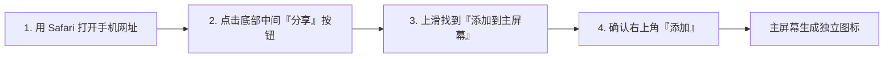

# 📱 人生智能编排体 (Life Planner AI)

> **懂你、判断、解释、推动你前进的贴身人生规划与决策助手**  
> *v2.0.0 起为完全自包含的 Android 原生应用（Kotlin + Jetpack Compose + 手机本地 SQLite）*

---

> [!IMPORTANT]
> **v2.0.0 原生版（推荐）**：APK 内置全部业务逻辑与本地数据库，**不需要电脑、不需要局域网后端**。目标、记录、统计、缺口检测、备份导入导出都能离线使用；只有 AI 功能需要你自备 OpenAI 兼容 API Key。
> 下文「手机快速访问」与 Python 服务端相关章节属于 **v1 遗留方案**，仍保留在仓库中可继续使用，但已不是手机端的主要形态。

> [!CAUTION]
> **v1 Python 服务端没有任何登录保护。**  
> `start.py` 会把服务绑定到 `0.0.0.0`，同一 Wi-Fi 下的任何人只要知道你电脑的地址，就能打开页面并读写你的全部数据（包括身高体重、疾病、过敏等健康信息）。请只在可信网络（自己家里的 Wi-Fi）使用。v2 原生 APK 不受此问题影响（数据只在本机）。

> [!WARNING]
> **隐私提示：配置了 AI Key 后，你的健康数据会发给第三方模型服务商。** 详见下文「安全守则与隐私透明声明」。

---

## 📱 手机端使用指南（优先阅读）

> [!IMPORTANT]
> **界面定位：手机优先。**  
> 界面按手机屏幕设计和适配，支持 **PWA (Progressive Web App)**，可添加到手机主屏幕以全屏方式运行。电脑浏览器也能打开使用，但没有针对电脑屏幕做专门优化。

### 1. 手机快速访问与真机连接
1. 确保手机与运行电脑连接在**同一个 Wi-Fi (局域网)** 下。
2. 在电脑双击运行 `run.bat` 或终端执行 `py start.py`。
3. 终端将输出本机局域网手机访问地址（例如 `http://192.168.1.100:8000`）。
4. 在手机浏览器中直接输入该网址打开。

---

### 2. 添加到主屏幕（PWA）

#### 🍎 苹果 iOS (iPhone / iPad) 安装步骤

- **安装后效果**：
  - 点击桌面图标以全屏 (Standalone) 方式启动，隐藏 Safari 地址栏与工具条；
  - 拥有专属应用图标；
  - 适配刘海屏安全区域。

#### 🤖 安卓 Android (小米 / 华为 / OPPO / vivo / 三星 / 微信)
1. **Chrome / 手机自带浏览器**：
   - 打开手机网址后，浏览器通常会自动弹出「**添加到主屏幕**」或「**安装应用**」气泡，点击即可；
   - 若未弹出，点击右上角三点菜单 `⋮` -> 选择「**添加到主屏幕**」或「**安装到手机**」。
2. **微信内置浏览器**：
   - 在微信聊天窗口中直接点击网址打开；
   - 点击右上角 `...` 菜单 -> 选择「**在系统浏览器中打开**」-> 按照上方步骤「添加到主屏幕」即可。

---

### 3. Android 原生 APK（v2，完全自包含）

仓库内含 Android 工程（位于 `android/`）。v2.0.0 起它是 **Kotlin + Jetpack Compose 原生应用**，不再是 WebView 套壳：

- 全部业务逻辑与数据都在手机本地（SQLDelight / SQLite），不连接电脑；
- 目标树、每日记录、统计趋势、生活缺口、JSON 备份导入导出全部离线可用；
- AI 功能（顾问 / 每日规划 / 复盘 / 目标拆解）只在你配置了 OpenAI 兼容 API Key 后启用；未配置或调用失败时明确报错，不生成替代内容；
- 界面与图表均为原生绘制，不依赖任何 CDN。

```
android/
├── core/                          # 纯 Kotlin 业务内核（可脱离 Android 跑单测）
│   └── src/main/kotlin/com/lifeplanner/core/
│       ├── model/                 # 领域模型
│       ├── logic/                 # 目标树/进度/统计/缺口/记录编排
│       ├── ai/                    # 提示词、危机筛查、响应校验、AiService
│       ├── json/                  # 备份导出/导入
│       ├── data/                  # SQLDelight 仓储实现
│       └── db/                    # 表结构与 SQL
├── app/
│   └── src/main/kotlin/com/lifeplanner/ai/
│       ├── AppContainer.kt        # 手动依赖容器
│       ├── ui/                    # 7 个 Compose 页面 + 通用组件 + 主题
│       ├── data/SettingsStore.kt  # AI 配置（SharedPreferences）
│       └── net/OkHttpTransport.kt # OpenAI 兼容端点传输
├── gradlew / gradlew.bat          # 已提交 Gradle Wrapper（8.4）
└── build.gradle
```

#### 📦 获取并安装 APK
1. **CI 构建**：推送到 `main` 或打 `v*` 标签后，GitHub Actions 会构建 Debug APK；打标签时还会自动创建 Release 并附上 APK。
2. **本地构建**：需要 JDK 17 与 Android SDK（compileSdk 34），然后：
   ```bash
   cd android
   ./gradlew assembleDebug
   # 产物：app/build/outputs/apk/debug/app-debug.apk
   ```
3. 安装到手机（USB 或 `adb install -r app-debug.apk`），打开 App 后在「设置」里填写 API Key 即可使用 AI；不填也能完整使用本地功能。

> **明文 HTTP 说明**：设置页允许 `http://` 仅用于本机/局域网 API 端点（如自建代理），公网地址必须使用 `https://`，保存时会校验；Android 清单允许明文流量只是为了支持局域网场景。

---

## 🌟 项目简介与核心理念

传统记事本与待办清单软件往往只是被动的“信息仓库”，既不了解用户的身体与作息情况，也不能给出理性的决策权衡。

**人生智能编排体 (Life Planner AI)** 是一个个人规划与决策助手：
- **了解你的情况**：以个人档案与身体状况（作息、过敏、饮食、疾病）为底线，参考你的愿景与技能；
- **帮你权衡**：面对选择时，按固定框架推演利弊，给出明确的建议；
- **说明理由**：采用 **6 段式分析结构**，指出行为对目标的促进或阻碍；
- **发现缺口**：基于你的记录，本地检测连续睡眠不足、蔬菜摄入不足、目标停滞等情况；每天可生成规划，晚上做复盘。

---

## 🤖 AI 功能的行为（请先了解）

- **未配置 `AI_API_KEY`，或模型不可用（网络不通、超时、鉴权失败、限流、返回内容无法解析）时，AI 功能会明确报错，不会生成任何替代内容。** 系统不会用本地模板冒充 AI，也不会为此写入任务或 AI 记录。
- AI 功能包括：每日规划、决策顾问、每日/每周复盘、目标 AI 拆解。
- **不依赖 AI 的功能不受影响**：仪表盘、目标管理、每日记录、缺口检测、统计与趋势图都在本地运行，没有 Key 也能正常使用。
- **周复盘的进度建议需要你确认才会写入。** AI 只给出建议值和理由，你点击确认后才会修改目标进度，AI 不会自己改进度。
- **删除目标是软删除**：目标被标记为已删除（其子目标一并标记），但它名下的历史任务保留，复盘历史仍可追溯。
- AI 记录会标注来源：`ai_model`（模型生成）、`crisis_safety_guard`（本地危机拦截）、`legacy_unverified`（旧版本遗留、来源未核实）。

---

## 🧩 核心功能模块

| 模块名称 | 核心能力 | 是否使用 AI |
| :--- | :--- | :--- |
| **D1 每日规划** | 综合历史记录、昨日复盘与进行中目标，生成今日行动清单与作息提醒 | 是 |
| **D2 决策顾问** | 针对具体行动咨询（如熬夜、聚餐、辞职），输出 **6 段式结构化研判** | 是 |
| **D3 每日/每周复盘** | 每日：完成度、亮点与偏差；每周：目标推进评估、最大摩擦点、下周策略，并给出需你确认的进度建议 | 是 |
| **D4 缺口检测** | 扫描近期记录，检测「睡眠负债」「营养失衡」「目标停滞」等 | 否（本地规则） |
| **目标分层树** | Vision / Long / Stage / Weekly 四级树形管理，支持 AI 拆解后批量采纳 | 拆解需要 AI |
| **30 天趋势图** | 学习时长、睡眠、心情、精力的折线图（Chart.js） | 否（本地计算） |

---

## 🎨 界面风格

- **底色**：纯黑 `#000000`，在 OLED 手机屏幕上较省电；
- **卡片**：半透明毛玻璃（`backdrop-filter: blur`）加细边框；
- **配色**：翡翠绿 (`#00F5A0`) 表示健康与完成，绯红 (`#FF4D5E`) 表示偏差与风险，冷灰 (`#CBD5E1`) 用于正文；
- **导航**：底部 Dock 导航栏（总览、目标、快速记录、AI 顾问、档案），方便单手操作。

---

## 🛠️ 技术栈与架构

### v2 Android 原生（当前主形态）
```
Kotlin 1.9.22 + Jetpack Compose (BOM 2024.02) + Material 3
├── core/  纯 Kotlin 业务内核
│   ├── SQLDelight 2.0.1 + SQLite（手机本地单用户库）
│   ├── kotlinx-datetime / kotlinx-serialization-json
│   ├── 目标树/软删除/进度状态机/统计/缺口检测
│   ├── 本地危机关键词筛查（命中即短路，不发网络请求）
│   └── JSON 备份导入导出（版本校验 + id 重映射）
└── app/   Android 接入层
    ├── 7 个 Compose 页面（总览/目标/记录/顾问/复盘/档案/设置）
    ├── OkHttp 4.12（OpenAI 兼容端点）
    ├── SharedPreferences（AI 配置）
    └── Storage Access Framework（备份文件读写）
```

### v1 遗留（仓库仍保留，可选）
```
后端：FastAPI + SQLAlchemy 2.0 + SQLite + Pydantic v2 + Uvicorn
前端：Jinja2 模板 + TailwindCSS(CDN) + Chart.js + PWA
Android：WebView 套壳（需连接电脑后端）
```
v1 与 v2 共用同一套业务语义（目标层级/软删除/进度规则/缺口口径/危机词表/错误码），
v2 的 `core` 单测覆盖这些规则，v1 的 422 个 pytest 仍可用于回归。

---

## 🚀 快速启动与操作说明

### 1. 运行环境准备
- 操作系统：Windows / macOS / Linux
- Python 版本：Python 3.10 及以上（安装时请勾选 `Add Python to PATH`）

### 2. 安装项目依赖
在项目根目录打开终端执行：
```bash
pip install -r requirements.txt
```

### 3. 一键启动服务
- **Windows 用户（最简方式）**：
  直接鼠标双击运行根目录的 `run.bat`。
- **命令行方式**：
  ```bash
  py start.py
  # 或
  python start.py
  ```

系统将在控制台显示（局域网地址以你的实际 IP 为准）：
```text
====================================================================
  🚀 人生智能编排体 (Life Planner AI) - 移动端全栈系统启动中
====================================================================
  💻 电脑本地访问:   http://127.0.0.1:8000
  📱 手机局域网访问: http://192.168.x.x:8000  👈 (手机连同一Wi-Fi直接打开)
--------------------------------------------------------------------
  【📱 手机端秒变独立全屏原生 App 指南】
  • 苹果 iOS (Safari):  打开手机地址 -> 底部分享按钮 ->「添加到主屏幕」
  • 安卓 (Chrome/微信): 打开手机地址 -> 菜单「添加到主屏幕」或「安装应用」
--------------------------------------------------------------------
  ⚠️ 未配置 AI_API_KEY：AI 功能将报错，其余功能正常      （仅在未配置 Key 时显示）
  ⚠️ 本服务无登录保护，请仅在可信 Wi-Fi 下使用
====================================================================
```
同时电脑将自动打开本地默认浏览器。

> [!CAUTION]
> `start.py` 固定绑定 `0.0.0.0`（不读取 `APP_HOST`），**同一网络内所有设备都能访问且无需登录**。

---

## ⚙️ 环境变量配置说明 (`.env`)

可从 `.env.example` 复制为 `.env` 后修改。配置项说明如下：

| 配置键名 | 默认值 | 作用说明 |
| :--- | :--- | :--- |
| `APP_HOST` | `127.0.0.1` | 配置项默认监听地址。注意：通过 `start.py` 启动时固定绑定 `0.0.0.0`，不受此项影响 |
| `APP_PORT` | `8000` | 服务运行端口号 |
| `DEBUG` | `False` | 调试模式（设为 `True` 时，直接 `py main.py` 启动会开启热重载）。服务对局域网可见且无登录保护，建议保持 `False` |
| `DATABASE_URL` | `sqlite:///./life_planner.db` | 本地 SQLite 数据库存储路径 |
| `AI_API_KEY` | *(空)* | 大模型 API Key。留空时所有 AI 功能会明确报错，不会用模板代替 |
| `AI_BASE_URL` | `https://api.openai.com/v1` | 大模型 API 服务地址，任何兼容 OpenAI 协议的端点都行 |
| `AI_MODEL` | `gpt-4o-mini` | 调用的模型名称 |

换服务商（如 DeepSeek、硅基流动、各类代理）时，请同时修改 `AI_API_KEY`、`AI_BASE_URL`、`AI_MODEL` 这三项。

> [!NOTE]
> **AI 的两种结果**：配置有效 Key 且模型可用时，AI 功能正常返回，记录来源标注为 `ai_model` 并附上所用模型名；否则返回错误（HTTP 503/502，附中文说明），**不会有任何替代内容**，也不会写入任务或 AI 记录。

---

## 🛡️ 安全守则与隐私透明声明

1. **危机内容拦截（在本地进行）**：
   - 当提问、复盘内容或规划相关的近期记录中出现自伤、轻生等表述时，系统在**本地**用关键词规则拦截，**命中时不会调用模型**；
   - 命中后停止常规规划，改为显示关怀信息和 24 小时心理援助热线（全国希望生命救助热线 `400-161-9995`、北京心理危机干预热线 `010-82951332`、青少年热线 `12355`、紧急报警 `110/120`）；
   - 这是基于关键词的简单规则，**不能覆盖所有表达方式，不能替代专业帮助**。
2. **健康与营养边界**：
   - 提示词要求模型不做疾病诊断、不推荐药物或处方，涉及就医或身体不适时建议寻求正规医疗机构协助；这是对模型的指令，不能保证模型每次都遵守；
   - 个人档案中的疾病、过敏与饮食忌口会作为上下文提供给模型。
3. **重大人生决策**：
   - 面对离职、创业、高额投资、借贷等决定，系统只提供权衡框架和利弊分析，仅供参考，最终决定由你自己做。
4. **数据存储与第三方传输（请务必阅读）**：
   - 所有日程、日记、心情、饮食及健康数据默认保存在本机的 `life_planner.db` SQLite 文件中。
   - **配置了 `AI_API_KEY` 之后，以下内容会随每次 AI 请求发送给你所配置的模型服务商**（`AI_BASE_URL` 指向的第三方）：
     - 个人档案：**身高体重、作息、饮食偏好与忌口、已知疾病/过敏**等健康信息，以及年龄、职业、愿景等；
     - 技能；
     - 进行中的目标；
     - **近 7 天完整日志**：包括饮食、睡眠、心情、精力、学习、运动、产出，以及你写的反思。
   - 这些内容一旦发出，就受该服务商的隐私政策约束，本项目无法控制。**使用前请确认你接受这一点**；不想发送就不要配置 `AI_API_KEY`。
   - **完全在本地计算、不会发送出去的功能**：缺口检测、统计概览、趋势图。
   - 危机内容的拦截在本地进行，命中时不会调用模型。
5. **网络访问**：
   - 服务没有登录保护；同一 Wi-Fi 下任何知道地址的人都能读写全部数据。请只在可信网络使用。

---

## 🧪 自动化测试

### v2 Android（Kotlin）
```bash
cd android
./gradlew :core:test             # 业务内核：96 个纯 JVM 单测
./gradlew :app:testDebugUnitTest # Robolectric 冒烟：建库/仓储/备份/AI 错误路径
```
需要 JDK 17 与 Android SDK 34。

### v1 Python
测试使用临时数据库，不会改动你的 `life_planner.db`；AI 部分使用测试桩，不会连接真实模型服务。

```bash
# 安装测试依赖（pytest 不在 requirements.txt 里）
pip install -r requirements-dev.txt

# 运行全部测试
py -m pytest -q
```

---

## 📄 授权与许可

本项目采用 MIT License 开源许可协议，欢迎自由定制与拓展。
