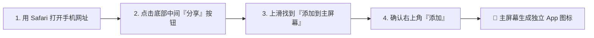

# 📱 人生智能编排体 (Life Planner AI)

> **懂你、判断、解释、推动你前进的贴身人生规划与决策随身智囊**  
> *专为智能手机打造的移动端原生级体验（OLED Pure Black & Liquid Glass 顶级视觉）*

---

## 📱 手机端 App 安装与使用指南（优先阅读）

> [!IMPORTANT]
> **做手机软件，不做电脑软件！**  
> 本系统专为手机移动端进行深度交互重构与视口适配，支持标准 **PWA (Progressive Web App)** 规范。无需前往应用商店，仅需 5 秒即可在 iPhone 或 Android 手机主屏幕生成**无浏览器地址栏、全屏运行、极速响应的原生级独立 App**。

### 1. 手机快速访问与真机连接
1. 确保手机与运行电脑连接在**同一个 Wi-Fi (局域网)** 下。
2. 在电脑双击运行 `run.bat` 或终端执行 `py start.py`。
3. 终端将高亮输出本机局域网手机访问地址（例如 `http://192.168.1.100:8000`）。
4. 在手机浏览器中直接输入该网址打开。

---

### 2. 变身独立手机 App（秒级安装）

#### 🍎 苹果 iOS (iPhone / iPad) 安装步骤

- **安装后效果**：
  - 点击桌面图标直接以**无边框全屏 (Standalone)** 启动，彻底隐藏 Safari 顶部网址栏与底部工具条；
  - 拥有专属高清应用图标，支持 iOS 手势后退滑动；
  - 完美适配 iPhone 灵动岛与刘海屏安全区域。

#### 🤖 安卓 Android (小米 / 华为 / OPPO / vivo / 三星 / 微信)
1. **Chrome / 手机自带浏览器**：
   - 打开手机网址后，浏览器通常会自动弹出「**添加到主屏幕**」或「**安装应用**」气泡，点击即可；
   - 若未弹出，点击右上角三点菜单 `⋮` -> 选择「**添加到主屏幕**」或「**安装到手机**」。
2. **微信内置浏览器**：
   - 在微信聊天窗口中直接点击网址打开；
   - 点击右上角 `...` 菜单 -> 选择「**在系统浏览器中打开**」-> 按照上方步骤「添加到主屏幕」即可。

---

### 3. 原生安卓应用工程 (Native Android Studio Project & APK)

本项目已为您内置了**完整的官方标准原生安卓工程**（位于 `android/` 目录），由原生 Kotlin/Java 与硬件加速底层驱动：

```
android/
├── app/
│   ├── src/main/java/com/lifeplanner/ai/
│   │   ├── MainActivity.kt        # 原生 Android 主 Activity (OLED纯黑、无边框全屏)
│   │   └── WebAppInterface.kt    # 原生触感马达震动、原生 Toast 桥接
│   ├── src/main/AndroidManifest.xml
│   └── src/main/assets/www/       # 内置离线原生应用前端包 (无需网络离线秒开)
├── build.gradle                   # Gradle 构建脚本
├── build_apk.bat                  # 一键编译生成 APK 批处理脚本
└── README.md                      # 原生工程开发与打包详细手册
```

#### 📦 获取并安装 APK：
1. **使用 Android Studio 直接生成 APK**：
   - 打开 [Android Studio](https://developer.android.google.cn/studio) 选择 **Open** 打开 `android/` 目录；
   - 点击顶部菜单：**Build -> Build Bundle(s) / APK(s) -> Build APK(s)**；
   - 编译完成后点击右下角 **locate** 即可获取生成的 `app-debug.apk`！
2. **将 APK 发送到手机安装**：
   - 通过微信、QQ、网盘或 USB 数据线直接传到手机，点击即可直接安装运行！
3. **USB 真机一键安装**：
   - 手机开启【开发者选项 -> USB调试】，连上电脑后在 Android Studio 点击右上角绿色 ▶ 运行按钮，软件直接安装到手机上并自启动！


---

## 🌟 项目简介与核心理念

传统记事本与待办清单软件往往只是被动的“信息仓库”，既不懂用户的身体与心理底座，也不能提供理性的决策权衡。

**人生智能编排体 (Life Planner AI)** 是一个有态度的贴身智囊：
- **懂你**：以个人档案与身体健康底座（作息、过敏、饮食、慢性病）为底线，知晓你的终极愿景与技能树；
- **会判断**：面对诱惑与选择时，以严密的逻辑框架推演利弊，给出有立场的建议；
- **会解释**：采用严格的 **6 段式分析架构**，指出行为对核心目标的促进或阻碍；
- **推着你前进**：主动发现生活节奏中的“缺口”（如连续睡眠负债、蔬菜摄入不足、目标停滞），每天晨间输出规划，夜间执行战术与战略双轨复盘。

---

## 🧩 核心功能模块

| 模块名称 | 核心能力 | 移动端交互亮点 |
| :--- | :--- | :--- |
| **D1 每日规划引擎** | 综合历史表现、昨日复盘与进行中目标，自动生成今日行动清单与健康作息警醒 | 底部一键落库今日待办，触控打卡即时完成 |
| **D2 智能决策顾问** | 针对具体行动咨询（如熬夜、聚餐、辞职），输出标准的 **6 段式结构化研判** | 移动端流式展开，结论醒目高亮，提供折中防线 |
| **D3 战术与战略复盘** | **每日复盘**：总结完成度、高光亮点与偏差；<br>**周度复盘**：全局位移评估、最大摩擦点剖析与下周策略 | 极简一键生成，历史记录时间轴滑动浏览 |
| **D4 缺口检测雷达** | 实时扫描分析近期记录，智能捕获「睡眠负债」、「营养失衡」、「目标停滞」等隐性危机 | 仪表盘置顶霓虹警示卡片，防患于未然 |
| **目标分层树系统** | 支持 Vision（愿景）/ Long（长期）/ Stage（阶段）/ Weekly（周）四级树形管理 | 支持 AI 智能拆解并**一键批量采纳**到目标树 |
| **30 天趋势大盘** | 对近 30 天的学习专注分钟、睡眠时长、心情状态与精力充沛度进行多维折线图表分析 | 基于 Chart.js 响应式流体图表，手指触摸查看数值 |

---

## 🎨 视觉与交互设计规范 (Pure Black & Liquid Glass)

本系统全面贯彻顶级金融量化终端级的设计规范：
- **底色与基调**：核心视窗与图表背景采用 **极致纯黑 `#000000`**，在手机 OLED 屏幕上实现像素级深邃纯黑与超低能耗；
- **半透明微透物理毛玻璃**：采用 `rgba(18, 22, 28, 0.75)` 搭配 `backdrop-filter: blur(20px)`，边缘以 `1px` 白金微折射边框浮雕点缀；
- **高定金融配色**：
  - 翡翠霓虹绿 (`#00F5A0`)：代表健康、推进与已完成指标；
  - 霓虹绯红 (`#FF4D5E`)：代表偏差警示与风险防线；
  - 钛金冷灰 (`#CBD5E1`)：代表高清晰度数据正文；
- **移动端专属 Dock**：底部悬浮微透玻璃导航栏（总览、目标、快速记、AI顾问、档案），单手持机大拇指轻松盲操。

---

## 🛠️ 技术栈与架构设计

```
人生智能编排体 (Life Planner AI)
├── 后端核心 (Backend Engine)
│   ├── FastAPI 0.110+ (高并发异步 API 框架)
│   ├── SQLAlchemy 2.0 (现代 ORM 映射与数据建模)
│   ├── SQLite 3 (本地零配置持久化数据库)
│   ├── Pydantic v2 (严格契约请求与响应数据校验)
│   └── Uvicorn (高性能 ASGI 异步服务器)
├── 前端与移动端 (Mobile PWA Frontend)
│   ├── Jinja2 模板引擎 (服务端无缝渲染)
│   ├── TailwindCSS CDN (实用优先原子样式，极速加载)
│   ├── Chart.js (轻量级 Canvas 响应式移动图表)
│   └── PWA Web Manifest & Service Metadata (离线与全屏独立运行能力)
└── 智能体编排 (AI Agent Network)
    ├── OpenAI 协议兼容客户端 (支持 DeepSeek-V3 / GPT-4o 等模型)
    ├── 智能启发式规则离线降级引擎 (AI 离线或无 Key 时保证 100% 顺畅运行)
    └── 动态上下文组装器 (Profile + Skills + Active Goals + Recent 7-Day Logs)
```

---

## 🚀 快速启动与操作说明

### 1. 运行环境准备
- 操作系统：Windows / macOS / Linux
- Python 版本：Python 3.10 及以上（安装时请勾选 `Add Python to PATH`）

### 2. 安装项目依赖
在项目根目录打开终端执行：
```bash
pip install -r requirements.txt
```

### 3. 一键启动服务
- **Windows 用户（最简方式）**：
  直接鼠标双击运行根目录的 `run.bat`。
- **命令行方式**：
  ```bash
  py start.py
  # 或
  python start.py
  ```

系统将在控制台自动显示：
```text
====================================================================
  🚀 人生智能编排体 (Life Planner AI) - 移动端全栈系统启动中
====================================================================
  💻 电脑本地访问:   http://127.0.0.1:8000
  📱 手机局域网访问: http://192.168.x.x:8000  👈 (手机连同一Wi-Fi直接打开)
--------------------------------------------------------------------
  【📱 手机端秒变独立全屏原生 App 指南】
  • 苹果 iOS (Safari):  打开手机地址 -> 底部分享按钮 ->「添加到主屏幕」
  • 安卓 (Chrome/微信): 打开手机地址 -> 菜单「添加到主屏幕」或「安装应用」
====================================================================
```
同时电脑将自动打开本地默认浏览器。

---

## ⚙️ 环境变量配置说明 (`.env`)

项目根目录包含 `.env` 文件（或可从 `.env.example` 复制生成）。配置项说明如下：

| 配置键名 | 默认值 | 作用说明 |
| :--- | :--- | :--- |
| `APP_HOST` | `0.0.0.0` | 服务监听地址（`0.0.0.0` 允许手机等同局域网设备接入） |
| `APP_PORT` | `8000` | 服务运行端口号 |
| `DEBUG` | `True` | 是否开启调试模式 |
| `DATABASE_URL` | `sqlite:///./life_planner.db` | 本地 SQLite 数据库存储路径 |
| `AI_API_KEY` | *(可选)* | 大模型 API Key（留空时自动启用智能启发式规则引擎） |
| `AI_BASE_URL` | `https://api.deepseek.com/v1` | 大模型 API 服务地址（兼容 OpenAI 规范） |
| `AI_MODEL` | `deepseek-chat` | 调用的模型名称（如 `deepseek-chat`, `gpt-4o` 等） |
| `AI_MOCK_FALLBACK` | `True` | 当大模型连接超时或无 Key 时，是否自动平滑降级 |

> [!TIP]
> **零配置即用保障**：若未填写 `AI_API_KEY`，系统内置的专家启发式规则引擎将自动无缝接管，D1 每日规划、D2 决策研判、D3 复盘推演与 D4 缺口雷达均能精准运行，绝不中断任何业务链路。

---

## 🛡️ 严格安全守则与隐私边界

1. **健康与营养边界守则**：
   - 绝不做疾病诊断，绝不推荐任何药物或处方；
   - 涉及就医或身体不适时，系统强制提示寻求正规医疗机构协助；
   - 严格尊重用户在个人档案中填写的既往病史、食物过敏与饮食禁忌，任何决策建议中均以此为第一防线。
2. **重大人生决策中立原则**：
   - 面对离职、创业、高额投资、借贷等不可逆决定时，系统只提供系统化权衡框架与利弊推演，明确声明仅供参考，不替用户作最终拍板。
3. **数据主权与隐私保护**：
   - 所有日程、日记、心情、饮食及健康数据均保存在本地 `life_planner.db` SQLite 文件中；
   - 数据完全由用户本地掌控，不向任何第三方未经许可上传隐私。

---

## 🧪 自动化测试与质量保障

项目配备了高密度的阶段验收与端到端集成测试套件，全面覆盖数据库、业务服务、AI 推演与前端接口。

### 运行全部测试
```bash
# 阶段 1：档案、技能矩阵与目标分层验收测试
py tests/test_stage1.py

# 阶段 2：D1规划、D2决策顾问 6 段式研判与目标拆解验收测试
py tests/test_stage2.py

# 阶段 3：多天生活数据注入、D4缺口雷达与D3双轨复盘验收测试
py tests/test_stage3.py

# 阶段 4：30天趋势图表、目标批量采纳与全流程端到端 (E2E) 闭环测试
py tests/test_stage4.py
```

### 一键回归所有测试套件
```bash
py tests/test_stage1.py ; py tests/test_stage2.py ; py tests/test_stage3.py ; py tests/test_stage4.py
```

- **阶段 4 验收范围涵盖**：
  1. `/api/stats/trends` 7天/14天/30天时间槽与指标数据点一致性；
  2. 目标批量采纳接口 `/api/goals/batch`（支持列表与包裹字典双格式）及挂载树形嵌套校验；
  3. 用户画像配置 -> 技能录入 -> 今日计划生成 -> 任务打卡 -> 决策研判 -> 生活日志 -> 缺口探测 -> 复盘报告 -> 统计趋势 全闭环业务链路；
  4. 6 大页面渲染及移动端 PWA `manifest.json` 与图标资源完整性。

---

## 📄 授权与许可

本项目采用 MIT License 开源许可协议，欢迎自由定制与拓展。
